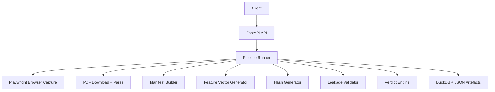

# FIFA Source-Lock Evidence Runner

## Executive Summary

The FIFA Source-Lock Evidence Runner is a FastAPI-based evidence pipeline designed to capture, validate, and preserve source material for football fixture analysis. The service produces auditable artifacts such as manifests, feature vectors, hashes, leakage reports, and a fixture-level verdict. It is intended as an MVP for building reproducible evidence around official match-source integrity.

## Problem Statement

Teams and analysts often need to reconstruct the provenance of fixture-related evidence before making predictions or assessments. This repository provides a structured workflow to:

- capture source material from a target page,
- optionally ingest supporting PDF reports,
- generate machine-readable evidence artifacts,
- apply a simple leakage-risk assessment,
- and persist everything for downstream audit.

## Architecture Diagram



## Folder Structure

```text
app/
  extractors/
  processors/
  governance/
  storage/
  main.py
  runner.py
  schemas.py
  config.py

data/
  feature_vectors/
  hashes/
  ledgers/
  manifests/
  parsed/
  pdfs/
  raw/

docs/
  ARCHITECTURE.md
  API.md
  DEPLOYMENT.md
  CONTRIBUTING.md

tests/
requirements.txt
dockerfile
```

## Technologies

- Python 3.12
- FastAPI
- Uvicorn
- Playwright
- httpx
- pdfplumber
- pandas
- DuckDB
- Docker
- GitHub Actions

## Local Development

### Prerequisites

- Python 3.12+
- A working Playwright browser installation

### Setup

```bash
python -m venv .venv
source .venv/bin/activate
pip install -r requirements.txt
playwright install chromium
```

### Run locally

```bash
uvicorn app.main:app --host 0.0.0.0 --port 8000
```

Then open:

- http://127.0.0.1:8000/
- http://127.0.0.1:8000/docs

## Docker

### Build

```bash
docker build -t fifa-source-lock-runner:latest .
```

### Run

```bash
docker run --rm -p 8000:8000 fifa-source-lock-runner:latest
```

## Docker Compose

```yaml
version: "3.9"
services:
  app:
    build: .
    ports:
      - "8000:8000"
    volumes:
      - ./data:/app/data
```

Run with:

```bash
docker compose up --build
```

## AWS ECR

The service can be published to Amazon ECR with the standard Docker workflow:

```bash
aws ecr create-repository --repository-name fifa-source-lock-runner
aws ecr get-login-password --region <region> | docker login --username AWS --password-stdin <account-id>.dkr.ecr.<region>.amazonaws.com
docker tag fifa-source-lock-runner:latest <account-id>.dkr.ecr.<region>.amazonaws.com/fifa-source-lock-runner:latest
docker push <account-id>.dkr.ecr.<region>.amazonaws.com/fifa-source-lock-runner:latest
```

## Kubernetes Deployment

A basic deployment manifest can be created using the container image from ECR or another registry. A simple example is documented in [docs/DEPLOYMENT.md](docs/DEPLOYMENT.md).

## CI/CD with GitHub Actions

A workflow file is present at [.github/workflows/test.yml](.github/workflows/test.yml). The repository is ready for CI expansion to include:

- dependency installation,
- unit and integration tests,
- container build validation,
- and image publication to ECR.

## Configuration

The service currently uses file-system-based configuration and local artifact output. The key runtime paths are:

- data/raw
- data/pdfs
- data/parsed
- data/manifests
- data/feature_vectors
- data/hashes
- data/ledgers

## Environment Variables

The current implementation does not require a large environment variable surface. Suggested variables for later hardening include:

- API_HOST
- API_PORT
- DATA_DIR
- DUCKDB_PATH
- PLAYWRIGHT_HEADLESS
- PDF_TIMEOUT_SECONDS

## API Endpoints

- GET / returns a basic health response.
- POST /runs/fifa/team-at-play creates a new evidence run.

## Security Considerations

- The MVP does not yet implement authentication or authorization.
- The service should not be exposed publicly without ingress controls.
- Secrets and credentials should be stored in a secret manager rather than committed to source control.
- Browser capture and PDF download should be constrained to trusted sources.

## Monitoring

Recommended monitoring targets:

- API latency and error rates,
- Playwright capture failures,
- PDF download failures,
- artifact generation success,
- DuckDB write errors.

## Troubleshooting

Common issues:

- Playwright browser missing: run playwright install chromium.
- Port already in use: change the port when launching Uvicorn.
- PDF parsing failures: verify the source PDF is accessible and valid.
- Missing output directories: ensure the service has write permissions to data/.

## Future Roadmap

- Add authentication and access control.
- Introduce asynchronous job processing.
- Add support for richer source reconciliation rules.
- Store artefacts in object storage and relational databases.
- Expand leakage detection and verdict logic.
- Add more robust tests and CI coverage.

## Documentation

Additional documentation:

- [docs/ARCHITECTURE.md](docs/ARCHITECTURE.md)
- [docs/API.md](docs/API.md)
- [docs/DEPLOYMENT.md](docs/DEPLOYMENT.md)
- [docs/CONTRIBUTING.md](docs/CONTRIBUTING.md)
