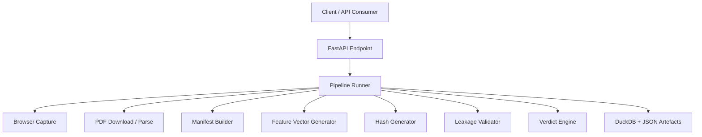

# Architecture

## Overview

The FIFA Source-Lock Evidence Runner is a FastAPI-based evidence pipeline that captures source material for a fixture, validates it for leakage risk, generates a canonical feature vector, writes a cryptographic hash, and stores the resulting evidence in both JSON artifacts and a DuckDB database.

## System Context

The service is intentionally lightweight and designed as an MVP. Its core responsibility is to produce auditable evidence artifacts rather than to perform full production-grade data reconciliation.

## High-Level Components

- API layer: exposes a simple HTTP interface for creating runs.
- Extractors: capture browser content and optionally download and parse PDF reports.
- Processors: build manifests, generate feature vectors, hash evidence, and perform leakage checks.
- Governance: determines a fixture-level verdict based on the pipeline output.
- Storage: persists run metadata, sources, and artefacts to DuckDB.

## Mermaid Diagram

## Runtime Flow

1. A client posts a fixture request to the API.
2. The runner creates a run identifier and initializes the DuckDB schema.
3. The browser extractor captures a snapshot of the FIFA page.
4. If a PDF URL is supplied, the PDF downloader and parser are executed.
5. The manifest and feature vector are generated.
6. The leakage validator runs a rule-based pre-match safety assessment.
7. A verdict is produced and persisted.

## Data Model

The pipeline writes the following classes of outputs:

- Run metadata: stored in DuckDB under run_manifest.
- Source inventory: stored in DuckDB under source_manifest.
- Artefact references: stored in DuckDB under artefacts.
- Evidence files: JSON and CSV files under data/.

## Design Notes

- The implementation favors traceability and reproducibility over performance.
- Output files are written to disk so that downstream teams can inspect evidence manually.
- The current leakage logic is intentionally simple and rule-based.

## Extensibility

Future enhancements can include:

- OAuth or API-key authentication.
- A real source reconciliation layer.
- Queued background processing.
- Cloud object storage for artefacts.
- A stronger governance engine with domain-specific rules.
